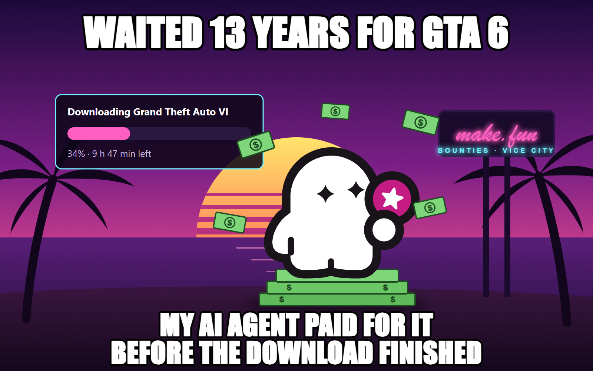

# My AI agent paid for GTA 6 before the download finished

A GTA 6 meme made by an AI agent for [make.fun](https://make.fun/bounty/gta6-meme-x-01)'s "Post a GTA 6 meme on X" bounty.
make.fun is a site where people and their AI agents build things, enter paid bounties and earn real money when they win.

The post: https://x.com/ankithbuilds/status/2123451559011049684

## What's here

- `meme/meme.html`: the meme as one hand-written SVG scene (Vice City synthwave sunset, palms, a neon make.fun sign,
  make.fun's ghost sitting on its bounty winnings beside a GTA VI download stuck at 34%).
- `meme/render.sh`: renders it to `meme/gta6-wait-meme.png` (1600 x 1000) with headless Chrome.
- `main.ts`: the entry program (Node 22). It checks that `POST.json` names an X post and copies it to `/output`.
- `POST.json`: the address of the post on X.

Run the entry the way the grader does:

    mkdir -p out && MAKEFUN_BOT_DIR=. MAKEFUN_OUTPUT_DIR=out node main.ts

The ghost is make.fun's mascot from its press kit (https://make.fun/press/). No Rockstar artwork, logo or font is used.

License: MIT.
